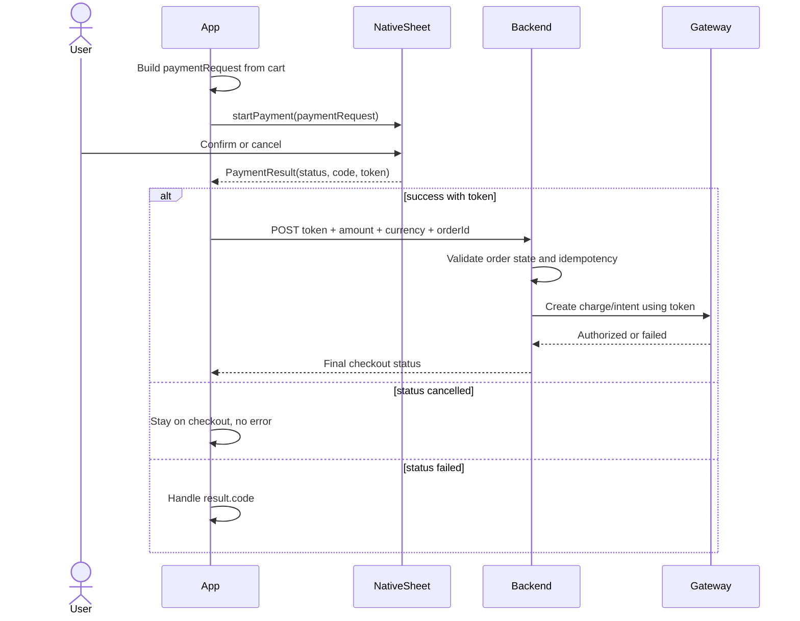

# Payment flow (end-to-end)

This page focuses on runtime behavior and integration boundaries so you can make your checkout resilient.

## Overview

The library does **not** charge the user directly. It opens the native wallet sheet, returns a tokenized payment payload, and lets your backend complete the charge with your gateway.

At a minimum:

1. App checks wallet availability (`isSupported` / `payServiceStatus()`).
2. App builds a `PaymentRequest` from cart items.
3. User confirms payment in the native sheet.
4. App receives `PaymentResult` (`status`, `code`, `token`).
5. Backend validates order context and charges through your provider.

## Runtime sequence



## PaymentResult outcomes

With [`onAuthorize`](/docs/guides/server-processing#charge-before-the-sheet-closes), your backend charges the token before `startPayment` resolves: on iOS while the Apple Pay sheet is still up, on Android after the Google Pay sheet has closed. The result below already reflects the charge, so don't send `result.token` to your backend again.

Every result has a `status`. When it isn't `'success'`, `code` says why:

| `status` | `success` | `code` | What to do |
| --- | --- | --- | --- |
| `'success'` | `true` | none | Forward `result.token` to your backend, unless `onAuthorize` already charged it. Wait for your backend before marking the order paid. |
| `'cancelled'` | `false` | `'CANCELLED'` | The user closed the sheet. Leave the checkout as it was and don't show an error. |
| `'failed'` | `false` | any other code | See the table below. |

Neither platform rejects the `startPayment` promise for these outcomes. `error` is a message for your logs, and it is also set on a cancel (`'Payment cancelled by user'`). Branch on `status` and `code`, not on the message.

```ts
import type { PaymentResult } from '@gmisoftware/react-native-pay'

function describeOutcome(result: PaymentResult): string | null {
  switch (result.status) {
    case 'success':
      return null
    case 'cancelled':
      return null // the user closed the sheet
    case 'failed':
      switch (result.code) {
        case 'IN_PROGRESS':
          return null // the payment already in flight will settle
        case 'NOT_AVAILABLE':
          return 'Apple Pay / Google Pay is not available. Choose another payment method.'
        case 'PROVIDER_ERROR':
          return 'The payment did not go through. Try again or choose another payment method.'
        default:
          return 'Something went wrong. Please try again later.'
      }
  }
}
```

### Error codes

| `code` | Meaning | Where it comes from | What to do |
| --- | --- | --- | --- |
| `'CANCELLED'` | The sheet closed before the user authorized. | iOS: the sheet closed without an authorization. PassKit doesn't say why, so a sheet that closes by itself also reports a cancel (see [Troubleshooting](/docs/troubleshooting#the-apple-pay-sheet-closes-right-away)). Android: the sheet returned `RESULT_CANCELED`, also when the user dismisses Google's sign-in prompt, or a Google Pay error has `CANCELED` / `ERROR_CODE_USER_CANCELLED`. | Nothing. Don't show an error. |
| `'IN_PROGRESS'` | Another payment is still in flight. No sheet was shown. | Both: `startPayment` called while a payment hasn't settled (see [`isPaymentInProgress()`](/docs/api/hybrid-payment-handler#ispaymentinprogress)). | Ignore it. The payment in flight settles normally. |
| `'CONFIGURATION'` | The request or the app's setup is invalid. Retrying won't help. | Both: an invalid amount, a negative total, an unknown merchant capability, invalid `shippingMethods`, and `supportedNetworks` that is empty, has an unknown name or has no network the platform offers. iOS: no Apple Pay merchant ID, an unknown `shippingType`. Android: more than two decimal places, an unknown `googlePayAllowedAuthMethods` value, `PRODUCTION` without `googlePayMerchantId`, `googlePayGateway` or `googlePayGatewayMerchantId`, and a Google Pay error with `DEVELOPER_ERROR`, `ERROR_CODE_INVALID_PARAMETERS`, `ERROR_CODE_MERCHANT_ACCOUNT_ERROR` or `ERROR_CODE_UNSUPPORTED_API_VERSION`. | Fix the request or the setup; `error` says what is wrong. Show the user a generic error. |
| `'NOT_AVAILABLE'` | The device can't show the payment sheet right now. | iOS: PassKit can't create the sheet, which Apple documents for a user who can't pay with any of the request's networks, or there is no active window to present it from. Android: no current activity, the Google Pay sheet fails to start, and a Google Pay error with `SIGN_IN_REQUIRED`, `API_NOT_CONNECTED`, `ERROR_CODE_BUYER_ACCOUNT_ERROR` or `ERROR_CODE_AUTHENTICATION_FAILURE`. | Offer another payment method. Show the pay button only as [Check availability](/docs/guides/availability#show-the-right-button) describes, from `isSupported` and `hasActiveCard`. |
| `'PROVIDER_ERROR'` | Apple Pay, Google Pay or your `onAuthorize` reported a failure. | Both: [`onAuthorize`](/docs/guides/server-processing#charge-before-the-sheet-closes) resolved with `'failure'`, rejected, or didn't settle within 25 seconds. Android: any other Google Pay error, such as a network or internal error, and payment data that is missing or can't be read. | Let the user retry or choose another payment method. After a timeout, your server may still have charged: reconcile the order. |
| `'UNKNOWN'` | Anything else. | iOS: an unexpected error while starting the payment. Android: an unexpected result code or exception, or a Google Pay error without a status. | Show a generic error and log `error`. |

A Google Pay error arrives either from `loadPaymentData` or as the sheet's `RESULT_ERROR`; both are mapped the same way, and its status code is added to `error`, for example `Payment error: <message> (status code 10)`.

### Start/processing exception (hook)

- `startPayment()` from `usePaymentCheckout` returns `null` when an exception occurs, and sets `error`.
- Handle this as an app/runtime failure path (show generic error + retry).

### Empty cart or invalid amounts (hook)

- Calling `startPayment()` with no cart items returns `null` and sets a "Cart is empty" error.
- An invalid amount or a negative total also returns `null` and sets `error`, without opening the sheet.
- Gate the pay button on `items.length > 0`.

## Token format

`PaymentToken.paymentData` is an opaque gateway payload and is **platform/gateway-dependent**:

- **Apple Pay (iOS):** Base64-encoded data from the Apple Pay token payload.
- **Google Pay (Android):** Tokenization payload from Google Pay (`tokenizationData.token`), whose schema depends on your configured gateway.

Always send the **entire token object** (or exactly the fields your gateway asks for) to your backend. Avoid parsing or transforming token payloads in the client.

## Server responsibilities (required)

Your backend should:

- Validate order ownership, amount, and currency from server-side order data.
- Use an idempotency key derived from your order ID to prevent duplicate charges. Don't use `PaymentResult.transactionId`: the device generates a new one for every result.
- Call gateway APIs with the provider-specific token mapping.
- Persist both wallet result and gateway result for audit/debug.
- Return a final, app-friendly checkout status.

## Before production

- [ ] **iOS:** Merchant ID and Payment Processing Certificate set up and installed in your gateway.
- [ ] **Android:** Google Pay API enabled; production gateway merchant ID and environment configured.
- [ ] **Backend:** Endpoint validates the token, amount, and context and uses the gateway SDK to create the charge.
- [ ] **Security:** Never log or expose raw token payloads; use HTTPS and secure storage for any sensitive data.

Next: [API: usePaymentCheckout](/docs/api/use-payment-checkout) or [Server-side processing](/docs/guides/server-processing).
